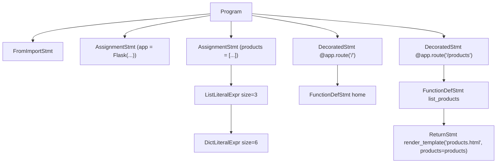

# 05 – AST & Nodes

## Two trees

1. **Python/Flask AST** — root `AST.Program`, built by `ProgramVisitor` +
   `FlaskVisitor` from the Flask parse tree.
2. **Template AST** — root `AST.template.html.HtmlDocument`, built by
   `TemplateVisitor` from the template parse tree. It mixes HTML, CSS, and Jinja
   nodes.

Both are real ASTs, not copied parse trees: grammar punctuation (colons,
parentheses, commas, tag brackets) is dropped, and nodes model program meaning.

## OOP design

- **Base class `AST.ASTNode`** (encapsulation): holds `lineNumber`,
  `columnNumber`, exposes `getChildren()` and `toString()`. Fields are private/
  protected with accessors.
- **Inheritance**: `Expression` and `Statement` extend `ASTNode`;
  `LiteralExpr` extends `Expression`; concrete nodes (e.g. `CallExpr`,
  `FunctionDefStmt`, `DictLiteralExpr`) extend those. Template nodes extend
  `HtmlNode` / `CssNode` / `JinjaNode`.
- **Polymorphism**: printing, semantic analysis, and model building all iterate
  over `ASTNode.getChildren()` and switch on runtime type via `instanceof`
  pattern matching. `getChildren()` and `toString()` are overridden per node.

Every node carries at least: its **type/name**, a **line number** (and column
when ANTLR provides it), its **children**, and its **value/attributes** (e.g.
`StringLiteralExpr` value, `FunctionDefStmt` name+params, `DictLiteralExpr`
keys/values).

## Conversion path

```
Parse Tree (ANTLR)
   → FlaskVisitor / TemplateVisitor  (visitor pattern)
   → AST Nodes (Program / HtmlDocument roots)
   → SymbolTableVisitor + AppModelBuilder
   → Semantic Analyzers
   → FlaskAppGenerator
```

## Printing

Two printers, both driven by `getChildren()`/`toString()` polymorphism:

- **`ASTPrinter`** – hierarchical, human-readable tree with box-drawing
  connectors. Works for *both* trees:
  - `ASTPrinter.print("PYTHON / FLASK AST", program)`
  - `ASTPrinter.print("TEMPLATE AST: base.html", templateRoot)`
- **`ASTGraphvizPrinter`** – writes `ast.dot` (Graphviz DOT) from the real
  Python AST for visualisation.

Enable at the CLI with `--print-python-ast` and `--print-template-ast`.

### Example (Python AST, trimmed)

```
==================== PYTHON / FLASK AST ====================
└─ Program (line 1)
   ├─ FromImportStmt (line 1)
   ├─ AssignmentStmt (line 3)
   │  ├─ IdentifierExpr("app") (line 3)
   │  └─ CallExpr (line 3)
   │     ├─ IdentifierExpr("Flask") (line 3)
   │     └─ StringLiteralExpr("app") (line 3)
   └─ AssignmentStmt (line 5)
      ├─ IdentifierExpr("products") (line 5)
      └─ ListLiteralExpr(size=3) (line 5)
         └─ DictLiteralExpr(size=6) (line 6)
```

## AST diagram

The real DOT graph is generated on every run into `ast.dot`. If Graphviz is
installed you can render it:

```powershell
dot -Tpng ast.dot -o ast.png
```

If Graphviz is not available, the same structure is shown as Mermaid:


