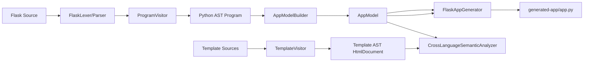

# Python to Template Data Flow

Proof that product data passes from the **Python AST** through **AppModel** into the **generated Flask application** (not hardcoded-only strings in the generator).

## Source example

```python
products = [{"id": 1, "name": "Transferred From Python AST", "price": 42.0, ...}]
```

## Python AST representation

- `AssignmentStmt` target `products`
- `ListLiteralExpr` containing `DictLiteralExpr` with string/number/boolean literals
- Built by `ProgramVisitor` from `FlaskParser`

## AppModel representation

`AppModelBuilder.extractProducts()` walks `ListLiteralExpr` / `DictLiteralExpr`:

- `AppModel.productRows` — list of maps
- `AppModel.productFields` — canonical field names
- `ProductSchema` — per-field types for X010/X011

## Template context

`render_template("p.html", products=products)` recorded in `AppModel.renderCalls`.

`CrossLanguageSemanticAnalyzer` validates template variable `products` against render context (X003).

## Generated output

`FlaskAppGenerator.generateAppPy()` emits:

```python
products = [
    {"id": 1, "name": "Transferred From Python AST", "price": 42.0, ...},
]
```

Templates iterate ``.

## Mermaid data-flow diagram



## Classes and methods

| Step | Class | Method |
|------|-------|--------|
| Parse Python | `ProgramVisitor` | `visitProg` |
| Build model | `AppModelBuilder` | `build`, `extractProducts` |
| Generate | `FlaskAppGenerator` | `generate`, `generateAppPy` |
| Cross-check | `CrossLanguageSemanticAnalyzer` | `checkTemplateContexts` |

## Test proof

`TestRunner.professionalEnhancementTests()`:

**`python product data flows through AST and AppModel into generated Flask application`**

1. Parses fixture with marker name `"Transferred From Python AST"`
2. Asserts `AppModel.productRows` contains the marker
3. Generates to temp directory
4. Asserts `app.py` contains the marker
5. Changes source to `"Changed Value From AST"` and asserts output updates

Also exported as architecture diagram: `docs/diagrams/generated/cross-language-data-flow.dot`
