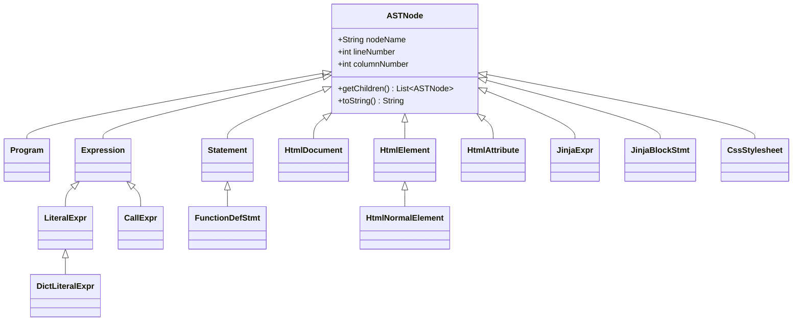

# AST Class Hierarchy

Based on hand-written classes under `src/AST/` (ANTLR generated code excluded).

**Polymorphism:** `ASTPrinter`, semantic analyzers, and `ASTGraphvizPrinter` call `getChildren()` and `toString()` on any `ASTNode` without knowing the concrete type.

**Synthetic nodes (line 0 allowed):** `TemplateAstForest` — wrapper for multi-template DOT export only.
