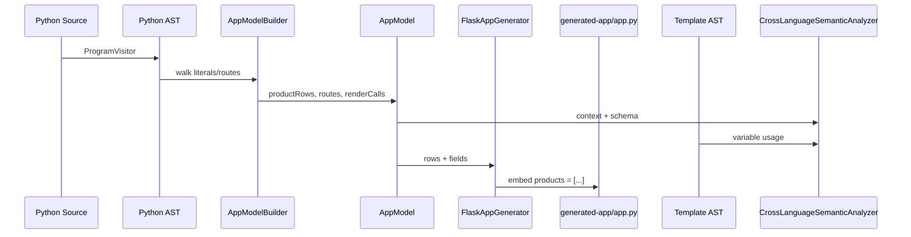

# Python-Template Data Flow

See also: [PYTHON_TO_TEMPLATE_DATA_FLOW.md](../PYTHON_TO_TEMPLATE_DATA_FLOW.md)



Architecture DOT (not a merged AST): `docs/diagrams/generated/cross-language-data-flow.dot`

Render SVG (optional):

```powershell
dot -Tsvg docs/diagrams/generated/cross-language-data-flow.dot -o cross-language-data-flow.svg
```
