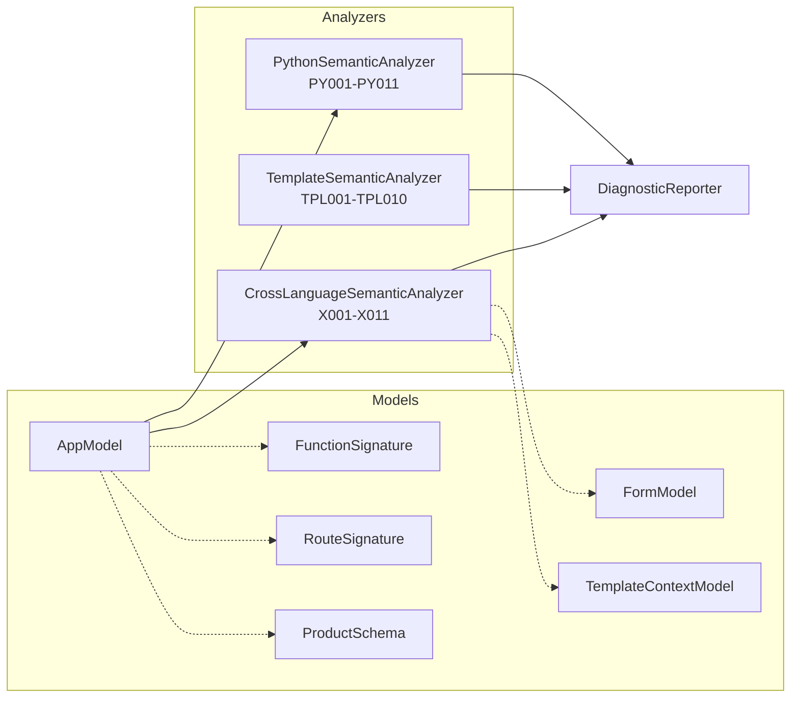

# Semantic Analysis Architecture



**32 semantic error codes** documented in `docs/SEMANTIC_ERRORS_CATALOG.md`.

Diagnostic format:

```
[ERROR PY001] app.py:12:4
Undefined variable 'x'.
Suggestion: define 'x' before using it.
```
