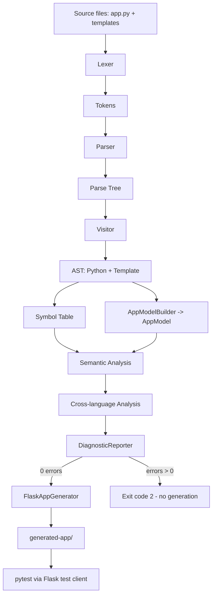

# 00 – نظرة عامة على المشروع (Project Overview)

> هذا الملف هو نقطة البداية لأي عضو في الفريق لم يكتب المشروع. اقرأه أولاً، ثم
> انتقل إلى [01_SETUP_AND_FIRST_RUN.md](01_SETUP_AND_FIRST_RUN.md).

## 1. ما فكرة المشروع؟

المشروع هو **مترجم (Compiler front-end) + مولّد كود (Code Generator)** مكتوب بلغة
**Java** باستخدام **ANTLR4**. يأخذ المشروع كمدخل:

- ملف تطبيق **Flask** مكتوب بمجموعة جزئية (subset) من **Python**.
- مجموعة قوالب **Jinja2 / HTML / CSS**.

ثم يقوم بكل مراحل التحليل الأمامية للمترجم (lexing, parsing, بناء AST, بناء
Symbol Table, تحليل دلالي)، وأخيراً **يولّد تطبيق Flask كاملاً وقابلاً للتشغيل**
داخل مجلد `generated-app/`.

## 2. ما المشكلة التي يحلها؟

الطالب/المطور يكتب وصفاً مبسطاً لتطبيق منتجات (products) في Python + قوالب، وقد
يقع في أخطاء مثل:

- استخدام متغير في القالب لم يُمرَّر من Python.
- استدعاء `url_for` لـ endpoint غير موجود.
- الوصول إلى مفتاح منتج (مثل `product.color`) غير موجود في البيانات.
- تكرار route أو دالة، أو `return` خارج دالة… إلخ.

المشروع **يكتشف هذه الأخطاء قبل التشغيل** ويعطي رسائل منظمة، ثم **يبني تطبيقاً
متكاملاً** (عرض/إضافة/تفاصيل/حذف) بدلاً من كتابته يدوياً.

## 3. لماذا يُسمّى Compiler Project رغم أن الناتج تطبيق Flask؟

لأنه ينفّذ فعلياً **مراحل المترجم الكلاسيكية**:

1. **Lexer**: تحويل النص إلى Tokens.
2. **Parser**: بناء Parse Tree وفق قواعد نحوية (Grammar).
3. **AST**: تحويل Parse Tree إلى شجرة تجريدية ذات معنى.
4. **Symbol Table**: تسجيل الرموز والنطاقات (Scopes).
5. **Semantic Analysis**: كشف الأخطاء المنطقية.
6. **Code Generation**: توليد كود الهدف (target code).

فالناتج (تطبيق Flask) هو ببساطة **اللغة الهدف (target language)** لمرحلة التوليد،
تماماً كما يولّد مترجم C كوداً بلغة الآلة.

## 4. اللغات والتقنيات المستخدمة

| التقنية | أين تُستخدم |
|--------|-------------|
| **Java (JDK 21)** | لغة المترجم نفسه (كل الكود في `src/`) |
| **ANTLR 4.13.2** | توليد الـ Lexers والـ Parsers من ملفات `.g4` |
| **Python subset** | اللغة المصدر للـ Flask side (يحلّلها `FlaskLexer`/`FlaskParser`) |
| **Flask** | إطار العمل للتطبيق الناتج (`generated-app/app.py`) |
| **Jinja2** | لغة القوالب داخل ملفات HTML |
| **HTML / CSS** | بنية وتنسيق واجهات التطبيق الناتج |
| **PowerShell** | سكربتات البناء والتشغيل والاختبار (`scripts/*.ps1`) |
| **pytest** | اختبار التطبيق الناتج عبر Flask test client |

## 5. ما هو الإدخال (Input)؟

مثال الإدخال الرسمي موجود في `examples/demo/`:

- **`examples/demo/app.py`**: كود Flask يعرّف قائمة منتجات `products` (list of dicts)
  و4 مسارات (`home`, `list_products`, `product_details`, `add_product`) مع
  استدعاءات `render_template` و`url_for`.
- **`examples/demo/templates/`**: قوالب `base.html`, `products.html`,
  `product_details.html`, `add_product.html` تستخدم ``,
  ``, ``, `{{ product.name }}`, `url_for(...)` … إلخ.

ملف إدخال «خاطئ» متعمّد موجود في `examples/invalid/` لعرض التشخيصات.

## 6. ما هو الإخراج (Output)؟

| المخرج | الوصف | أين |
|--------|-------|-----|
| **Diagnostics** | قائمة أخطاء/تحذيرات منظّمة (نوع، رمز، ملف، سطر، عمود، اقتراح) | stdout عبر `DiagnosticReporter` |
| **Python AST** | شجرة تجريدية لكود Flask، جذرها `Program` | تُطبع بـ `--print-python-ast` |
| **Template AST** | شجرة تجريدية لكل قالب، جذرها `HtmlDocument` | تُطبع بـ `--print-template-ast` |
| **Symbol Table** | جدول الرموز والنطاقات | تُطبع بـ `--print-symbol-table` |
| **AppModel** | نموذج بيانات يجمع routes + render calls + url_for + بيانات المنتجات | داخلي (جسر بين المراحل) |
| **ast.dot** | تمثيل Graphviz للـ Python AST | ملف `ast.dot` في جذر المشروع |
| **generated-app/** | تطبيق Flask كامل قابل للتشغيل | مجلد `generated-app/` |

## 7. المراحل الرئيسية (Pipeline)

التفاصيل الكاملة لكل انتقال في [03_COMPILER_PIPELINE.md](03_COMPILER_PIPELINE.md).

## 8. الفرق بين Interpreter وCompiler وTranspiler وهذا المشروع

- **Interpreter**: يقرأ الكود المصدري وينفّذه مباشرة دون إنتاج ملف هدف.
- **Compiler**: يترجم من لغة مصدر إلى لغة هدف (غالباً أدنى مستوى) ويُنتج مخرجاً.
- **Transpiler (Source-to-source compiler)**: يترجم من لغة عالية إلى لغة عالية أخرى.
- **هذا المشروع**: أقرب إلى **Compiler / Generator**. يحلّل لغة مصدر (Python subset
  + Jinja/HTML/CSS)، يبني AST وSymbol Table ويقوم بتحليل دلالي (مثل أي compiler
  front-end)، ثم **يولّد** مشروع Flask جاهزاً (مرحلة code generation). هو ليس
  Interpreter لأنه لا ينفّذ Python، وليس Transpiler بحتاً لأنه لا يحوّل ملفاً إلى
  مقابله سطراً بسطر، بل يبني تطبيقاً متكاملاً من نموذج البيانات المستخرج.

## 9. حدود اللغة المدعومة (مهم جداً — لا نبالغ)

المشروع **لا يدعم Python أو HTML أو CSS بالكامل**، بل **Subset** كافٍ لتطبيق Flask
تعليمي:

- **Python subset** (من `FlaskParser.g4`): imports (`from x import y`), الإسناد
  والإسناد المتسلسل، `def` مع parameters، decorators (`@app.route`)، `if/elif/else`،
  `while`, `for`, `break`, `continue`, `return`, `pass`, `global`, `del`، الاستدعاءات
  مع positional + keyword args، الوصول للسمات والفهرسة، lambda، والعمليات
  الحسابية/المنطقية/المقارنة، والقيم الحرفية (أرقام/نصوص/بوليان/None/list/set/dict).
  **غير مدعوم**: comprehensions، `try/except`، `with`, `async`, f-strings، إلخ.
- **Jinja subset**: `{{ expr }}`, ``, ``, ``,
  ``, ``, filters (`| name`)، والوصول للسمات والاستدعاءات.
- **HTML subset**: العناصر العادية/ذاتية الإغلاق/الفارغة، السمات، النص، و`<style>`.
- **CSS subset**: selectors، declarations، values، functions، وقيم Jinja داخل CSS.

## 10. أهم الإنجازات الحالية (بأدلة فعلية)

- **بناء من الصفر ينجح**: `Build succeeded -> out/` مع **121 ملف Java**.
- **تحليل الـ demo بلا أخطاء**: `Errors: 0   Warnings: 0`.
- **توليد ناجح**: `Generated 10 files`.
- **اختبارات Java**: `Passed: 30   Failed: 0` (`tests.TestRunner`).
- **اختبارات التطبيق الناتج**: `8 passed` (pytest عبر Flask test client).
- **إثبات أن التوليد ليس Hardcoded**: أعيدت تسمية منتج في `examples/demo/app.py` إلى
  `"Test Product From AST"` وظهر نفسه حرفياً في `generated-app/app.py` (السطر 12).

> راجع النتائج الكاملة في [01_SETUP_AND_FIRST_RUN.md](01_SETUP_AND_FIRST_RUN.md)
> و[14_TESTS_FILE_BY_FILE.md](14_TESTS_FILE_BY_FILE.md).
