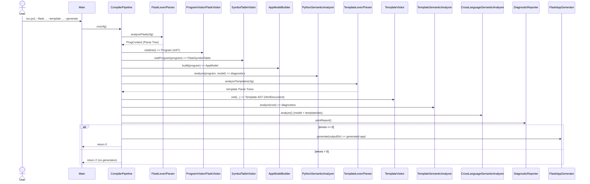

# 03 – مسار المترجم (Compiler Pipeline)

المرجع الفعلي: `src/Main.java` و`src/pipeline/CompilerPipeline.java`.

## 1. الفكرة العامة

`Main` لا يحوي أي منطق مترجم؛ مهمته فقط قراءة الوسائط (CLI) وملء كائن
`CompilerPipeline.Config`، ثم استدعاء `new CompilerPipeline().run(cfg)`.
كل المنطق داخل `CompilerPipeline` (السطور 71–100 للدالة `run`).

## 2. مخطط التسلسل (Sequence)

## 3. الانتقالات — ما الكائن الممرّر ونوعه ومحتواه

| # | من → إلى | الكائن الممرّر | النوع | المحتوى |
|---|----------|----------------|-------|---------|
| 1 | Main → Pipeline | `cfg` | `CompilerPipeline.Config` | مسارات + رايات (flaskFile, templatePath, generate, …) |
| 2 | ملف → Lexer | نص المصدر | `CharStream` | عبر `CharStreams.fromPath` |
| 3 | Lexer → Parser | Tokens | `CommonTokenStream` | تيار الرموز |
| 4 | Parser → Visitor | Parse Tree | `FlaskParser.ProgContext` | شجرة اشتقاق كاملة |
| 5 | Visitor → المراحل | AST | `Program` | جذر Python AST |
| 6 | Program → Symbol | جدول الرموز | `FlaskSymbolTable` | النطاقات والرموز |
| 7 | Program → Model | نموذج | `AppModel` | routes/renderCalls/urlFor/products |
| 8 | Templates → Visitor | Parse Tree لكل قالب | `TemplateParser` contexts | يتحوّل إلى `HtmlDocument` |
| 9 | كل مرحلة → التشخيص | Diagnostics | `DiagnosticReporter` | يجمع كل الرسائل |

الحقول تُخزَّن كحالة داخل الـ pipeline: `pythonProgram`, `model`, `symbolTable`,
`templateAsts` (Map من اسم القالب إلى جذر شجرته).

## 4. تفصيل `analyzeFlask` (السطور 104–156)

1. يبني `CharStream` من الملف، ثم `FlaskLexer`.
2. **يزيل مستمعي أخطاء ANTLR الافتراضيين** ويضيف `CompilerErrorListener` (لتحويل
   أخطاء اللكسر/البارسر إلى Diagnostics بدل طباعتها على stderr).
3. ينشئ `CommonTokenStream` ثم `FlaskParser`، ويستدعي القاعدة الجذر `parser.prog()`
   فيحصل على `ProgContext`.
4. **حارس مهم (السطر 123):** إذا كان `reporter.hasErrors()` صحيحاً بعد الـ parse،
   يتوقّف فوراً (لأن شجرة الاشتقاق قد تكون تالفة، ويمنع NullPointerException عند بناء
   الـ AST).
5. `new ProgramVisitor().visit(tree)` → `Program` (الـ AST).
6. `SymbolTableVisitor.visitProgram(program)` → `FlaskSymbolTable`.
7. `new AppModelBuilder().build(program)` → `AppModel`.
8. `new PythonSemanticAnalyzer(...).analyze(program, model)` → تشخيصات Python.
9. يكتب `ast.dot` من الـ AST الحقيقي.
10. يطبع routes وعدد المنتجات وحقولها (وهو مصدر السطور التي نراها في الطرفية).

## 5. تفصيل `analyzeTemplates` (السطور 160–196)

- يجمع ملفات `.html` (ملف واحد أو كل ملفات مجلد، مرتّبة).
- **تمريرة أولى:** يحلّل كل القوالب ويخزّن جذورها في `templateAsts` — حتى تعرف فحوص
  `include`/`extends`/`render` مجموعة القوالب المتاحة.
- **تمريرة ثانية:** يشغّل `TemplateSemanticAnalyzer` على كل قالب (ويطبع شجرته عند
  `--print-template-ast`).

## 6. متى يُسمح بالتوليد؟ (قرار الجودة)

في `run` (السطور 84–95):
- يُطبع التقرير دائماً (`reporter.printReport()`).
- **إن كانت هناك أخطاء** (`reporter.hasErrors()`): تُطبع «Analysis FAILED» و**يُرجَع
  الكود 2 دون توليد**.
- **إن لم تكن هناك أخطاء**: تُطبع «Analysis completed successfully»، وإذا كانت الراية
  `--generate` مفعّلة و`--analyze-only` غير مفعّلة و`model != null`، يُستدعى
  `generate(cfg)`.

> التحذيرات (Warnings) **لا تمنع** التوليد؛ الأخطاء (Errors) فقط تمنعه.

## 7. ماذا يحدث عند Semantic Error؟

يُسجَّل عبر `DiagnosticReporter` بشدة `ERROR`. عند فحص `run` النهائي يرى
`hasErrors()==true` فيُرجع **2** ولا يُنشئ `generated-app/`. لا يتوقّف التحليل عند أول
خطأ؛ بل تُجمَع كل الأخطاء في التمريرة الواحدة ثم تُعرض معاً.

## 8. أكواد الخروج (Exit Codes) الفعلية

| الكود | المصدر | المعنى |
|-------|--------|--------|
| 0 | `CompilerPipeline.run` | نجاح (وتوليد إن طُلب) |
| 2 | `CompilerPipeline.run` | فشل التحليل (توجد أخطاء) — لا توليد |
| 3 | `CompilerPipeline.run` | خطأ إدخال/إخراج (IOException) |
| 64 | `Main` | خطأ استخدام CLI (وسيط غير معروف/ناقص) |
| 66 | `Main` | ملف الإدخال (flask/template) غير موجود |

`Main.main` يستدعي `System.exit(code)` فقط عندما يكون `code != 0`.
