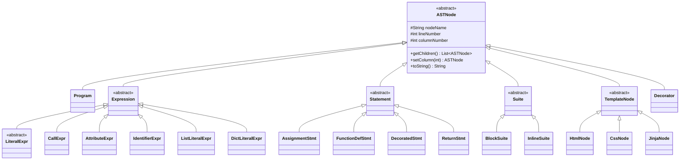

# 05 – من Parse Tree إلى AST

## 1. الفرق بين Parse Tree و AST

- **Parse Tree (Concrete Syntax Tree)**: تمثيل **حرفي** لكل قاعدة نحوية طُبّقت،
  ويحوي كل الرموز حتى الأقواس والفواصل و`NEWLINE`. ينتجه ANTLR (أصناف `*Context`).
- **AST (Abstract Syntax Tree)**: تمثيل **مجرّد** يحتفظ بالمعنى فقط ويحذف التفاصيل
  النحوية الزائدة. نبنيه بأنفسنا عبر الـ Visitors (أصناف تحت `src/AST/`).

## 2. مثال حقيقي من `examples/demo/app.py`

السطر:

```python
@app.route("/products")
def list_products():
    return render_template("products.html", products=products)
```

**في المصدر**: نص.

**بعد Tokenization** (مبسّط): `AT IDENTIFIER(app) DOT IDENTIFIER(route) LPAREN
DOUBLE_STRING("/products") RPAREN NEWLINE DEF IDENTIFIER(list_products) LPAREN RPAREN
COLON NEWLINE INDENT RETURN IDENTIFIER(render_template) LPAREN ... RPAREN NEWLINE
DEDENT`.

**في Parse Tree** (مختصر): `decorated → decorator(AT primary(app.route("/products")))
+ func_def(DEF list_products (…) COLON suite(...))` — بكل الرموز الوسيطة.

**في AST**:

```text
DecoratedStmt (line 15)
├─ Decorator (line 15)
│  └─ CallExpr (line 15)                # app.route("/products")
│     ├─ AttributeExpr(.route)
│     │  └─ IdentifierExpr("app")
│     └─ StringLiteralExpr("\"/products\"")
└─ FunctionDefStmt(list_products) (line 15, col ...)
   └─ BlockSuite (line 16)
      └─ ReturnStmt (line 17)
         └─ CallExpr (line 17)          # render_template(...)
            ├─ IdentifierExpr("render_template")
            └─ StringLiteralExpr("\"products.html\"")   + kwargs {products: IdentifierExpr("products")}
```

لاحظ أن `LPAREN`, `COLON`, `NEWLINE`, `INDENT` اختفت — هذا هو «التجريد».

## 3. لماذا لا نستخدم Parse Tree مباشرة؟

- **Semantic Analysis**: يحتاج عقداً ذات معنى (هل هذا `CallExpr` لـ `render_template`؟)
  بدل التنقّل بين رموز نحوية.
- **Symbol Table**: يحتاج أسماء متغيرات/دوال، لا أقواساً.
- **Code Generation**: يحتاج بيانات مجرّدة (routes، منتجات) لا تفاصيل صياغة.
  الـ AST يجعل كل هذا أبسط وأكثر متانة (مثلاً `AppModelBuilder` يعتمد كلياً على أنواع
  عقد الـ AST، لا على النص).

## 4. العقدة الأساسية `ASTNode`

الملف `src/AST/ASTNode.java` (abstract). الحقول:

- `nodeName : String` — اسم العقدة.
- `lineNumber : int` — رقم السطر في المصدر.
- `columnNumber : int` — العمود (افتراضي `-1` أي غير معروف).

أهم التوابع: `getChildren() : List<ASTNode>` (تُعاد فارغة افتراضياً وتُعاد تعريفها في
الأبناء)، `setColumn(int)` (fluent setter)، و`toString()` الذي يُظهر
`name (line N[, col C])`. **Polymorphism** يظهر هنا: الطابعات والمحلّلات تتعامل مع
`ASTNode` عبر `getChildren()`/`toString()` دون معرفة النوع الدقيق.

## 5. مخطط الأصناف (مبسّط، أسماء حقيقية)



القوائم الكاملة للعقد في [06_AST_NODES_FILE_BY_FILE.md](06_AST_NODES_FILE_BY_FILE.md).

## 6. `ast.dot` — تمثيل Graphviz

- **من يولّده؟** `AST.ASTGraphvizPrinter.print(root, "ast.dot")`، ويُستدعى من
  `CompilerPipeline.analyzeFlask` (السطر 142) على **Python AST** (الجذر `Program`).
- **ماذا يحتوي؟** رسم `digraph AST { ... }` حيث كل عقدة دائرة مُعنونة بـ
  `node.toString()` وأسهم من الأب إلى كل ابن (`getChildren()`).
- **هل يمثّل Python أم Template؟** يمثّل **Python AST فقط** في التدفّق الحالي.
- **كيف يُفتح ويُحوَّل؟**

```powershell
dot -Tpng ast.dot -o ast.png
dot -Tsvg ast.dot -o ast.svg
```

> ملاحظة: `ASTPrinter` (نصّي، شجري) يُستخدم للطباعة على الطرفية وللاختبارات، وهو
> يعمل لكلا الشجرتين لأنه يعتمد فقط على `getChildren()`/`toString()`.
