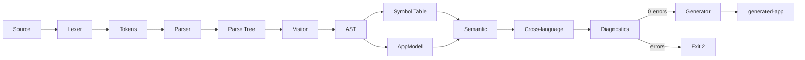

# الدليل الشامل للمشروع (FULL PROJECT GUIDE)

> كتاب تدريبي موحّد للفريق. يجمع أهم المحتوى؛ التفاصيل الكاملة في الملفات المرقّمة
> داخل `docs/team-guide/`. جميع الأرقام والنتائج هنا **فعلية** التُقطت من الطرفية.

## جدول المحتويات
1. [مقدمة](#1-مقدمة)
2. [متطلبات المشروع](#2-متطلبات-المشروع)
3. [فكرة المشروع](#3-فكرة-المشروع)
4. [البيئة والأدوات](#4-البيئة-والأدوات)
5. [بنية الملفات](#5-بنية-الملفات)
6. [مسار المترجم](#6-مسار-المترجم)
7. [ANTLR](#7-antlr)
8. [Lexer](#8-lexer)
9. [Parser](#9-parser)
10. [Parse Tree](#10-parse-tree)
11. [AST](#11-ast)
12. [Nodes](#12-nodes-ast-nodes)
13. [Visitors](#13-visitors)
14. [Symbol Table](#14-symbol-table)
15. [Diagnostics](#15-diagnostics)
16. [Semantic Analysis](#16-semantic-analysis)
17. [Cross-language Analysis](#17-cross-language-analysis)
18. [AppModel](#18-appmodel)
19. [Code Generation](#19-code-generation)
20. [تطبيق Flask الناتج](#20-تطبيق-flask-الناتج)
21. [Tests](#21-tests)
22. [التشغيل من الصفر](#22-التشغيل-من-الصفر)
23. [مثال تنفيذي كامل](#23-مثال-تنفيذي-كامل)
24. [Mapping مع المتطلبات](#24-mapping-مع-المتطلبات)
25. [المشكلات التي حُلّت](#25-المشكلات-التي-حُلّت)
26. [القيود الحالية](#26-القيود-الحالية)
27. [أسئلة اللجنة](#27-أسئلة-اللجنة)
28. [الخاتمة](#28-الخاتمة)
29. [ملاحق الأوامر](#29-ملاحق-الأوامر)
30. [فهرس الملفات](#30-فهرس-الملفات)

---

## 1. مقدمة
مترجم مكتوب بـ **Java + ANTLR4** يأخذ تطبيق **Flask** (Python subset) وقوالب
**Jinja2/HTML/CSS**، ينفّذ مراحل المترجم كاملة، ثم **يولّد تطبيق Flask يعمل** في
`generated-app/`. تفصيل: [00_PROJECT_OVERVIEW](00_PROJECT_OVERVIEW.md).

## 2. متطلبات المشروع
Lexer/Parser للغتين، شجرتا AST، OOP/وراثة/تعدّد أشكال، معلومات العقدة ورقم السطر، ≥5
أخطاء دلالية، نقل البيانات من Python إلى Jinja، توليد واجهات (عرض/إضافة/تفاصيل/حذف) مع
تنقّل، Symbol Table، طباعة العقد والشجرة، تقرير ومخطط AST. الربط الكامل في
[17_REQUIREMENTS_MAPPING](17_REQUIREMENTS_MAPPING.md).

## 3. فكرة المشروع
تحويل وصف مبسّط لتطبيق منتجات (Python + قوالب) إلى تطبيق Flask كامل، مع اكتشاف الأخطاء
(النحوية والدلالية وأخطاء الربط) قبل التوليد.

## 4. البيئة والأدوات
JDK 17+ (اختُبر على 21)، PowerShell، ANTLR 4.13.2 (`lib/`)، Python 3.10+ (للاختبارات)،
Graphviz (اختياري). التجهيز الكامل في [01_SETUP_AND_FIRST_RUN](01_SETUP_AND_FIRST_RUN.md).

## 5. بنية الملفات
`src/` (antlr, AST, SymbolTable, diagnostics, model, semantic, generator, pipeline,
Tests, Main)، `scripts/`, `examples/`, `generated-app/`, `docs/`, `lib/`, `out/`.
تفصيل: [02_PROJECT_STRUCTURE](02_PROJECT_STRUCTURE.md).

**أعداد فعلية**: 121 ملف Java (109 يدوي + 12 مولّد ANTLR)، 85 ملف AST، 10 ملفات مولّدة.

## 6. مسار المترجم


التفصيل + Exit Codes في [03_COMPILER_PIPELINE](03_COMPILER_PIPELINE.md).

## 7. ANTLR
أربع قواعد `.g4` تُولَّد بـ `generate-antlr.ps1` (`-Dlanguage=Java -package antlr
-visitor`). تُنتج 12 ملف Java **لا تُعدّل يدوياً**. تفصيل: [04](04_ANTLR_LEXER_AND_PARSER.md).

## 8. Lexer
`FlaskLexer.g4` يعالج الكلمات المفتاحية والأرقام والنصوص و**الإزاحة** (INDENT/DEDENT)
و**ضمّ الأسطر** داخل الأقواس (عدّاد `opened`). `TemplateLexer.g4` يستخدم **أنماطاً**
(TAG/JINJA_EXPR/JINJA_STMT/CSS).

## 9. Parser
`FlaskParser.g4` جذره `prog`، بسُلّم أولويات للتعبيرات، ويدعم dict/list/set literals
وkeyword args وdecorators. `TemplateParser.g4` جذره `template`.

## 10. Parse Tree
تمثيل حرفي (أصناف `*Context`) بكل الرموز. نحوّله إلى AST لأنه غير عملي للتحليل والتوليد.
تفصيل: [05](05_PARSE_TREE_AND_AST.md).

## 11. AST
جذر Python هو `Program`، وجذر القالب `HtmlDocument`. القاعدة `ASTNode` تحمل
`nodeName/lineNumber/columnNumber` و`getChildren()`/`toString()`.

## 12. Nodes (AST nodes)
85 عقدة تحت `src/AST/`. أمثلة محورية: `CallExpr`, `AttributeExpr`, `ListLiteralExpr`,
`DictLiteralExpr`, `FunctionDefStmt`, `DecoratedStmt`, `JinjaAttrExpr`,
`JinjaForStmt`, `HtmlDocument`. المرجع الكامل: [06](06_AST_NODES_FILE_BY_FILE.md).

<a id="ast-nodes"></a>
**التسلسل الوراثي (مختصر):**
```text
ASTNode → {Program, Decorator, Expression*, Statement*, Suite*, TemplateNode*}
Expression → LiteralExpr* + {Call/Attribute/Identifier/Index/Binary/Unary/Not/Compare/Lambda}
             + {List/Set/Dict}LiteralExpr
Statement  → {Assignment, AssignmentChain, FunctionDef, Decorated, Return, If, While,
              For, Break, Continue, Pass, FromImport, Global, Del, Class, Expression}Stmt
TemplateNode → HtmlNode* + CssNode* + JinjaNode*
```

## 13. Visitors
`FlaskVisitor` و`ProgramVisitor` (Python)، و`TemplateVisitor` (قوالب) يرثون
`*BaseVisitor<ASTNode>`. تفصيل: [07](07_VISITORS_FILE_BY_FILE.md).

## 14. Symbol Table
`FlaskSymbolTable` + `SymbolTableVisitor` بنطاقات (global/function/loop/if/class).
تمييز جوهري بين **التعريف** (يُضاف للنطاق) و**الاستخدام** (attributes/built-ins في قوائم
منفصلة) لمنع تحذيرات «already declared» الكاذبة. تفصيل: [08](08_SYMBOL_TABLE_AND_SCOPES.md).

## 15. Diagnostics
`Diagnostic`(code/kind/severity/message/file/line/column/suggestion) +
`DiagnosticReporter` (جمع/عرض) + `CompilerErrorListener` (ربط أخطاء ANTLR). تفصيل:
[09](09_DIAGNOSTICS_AND_ERROR_HANDLING.md).

## 16. Semantic Analysis
- **Python** (`PythonSemanticAnalyzer`): PY001–PY007.
- **Template** (`TemplateSemanticAnalyzer`): TPL001–TPL006.
- كلها تُجمَع دون توقّف عند أول خطأ. تفصيل: [10](10_SEMANTIC_ANALYSIS.md).

## 17. Cross-language Analysis
`CrossLanguageSemanticAnalyzer`: X001 (قالب مفقود)، X002 (endpoint مفقود)، X003
(متغيّر سياق غير مُمرَّر)، X004 (`product` غير مُمرَّر)، X005 (مفتاح منتج خارج الـ schema).
هذا هو **إثبات الربط بين الشجرتين**. تفصيل: [11](11_CROSS_LANGUAGE_LINKING.md).

## 18. AppModel
`AppModel` (routes/renderCalls/urlForRefs/productRows/productFields) يبنيه
`AppModelBuilder` من الـ AST؛ هو الجسر بين Python والقوالب والمولّد.

## 19. Code Generation
`FlaskAppGenerator` يأخذ `AppModel` ويكتب 10 ملفات UTF-8. **بيانات المنتجات وحقولها
مستخرجة من الـ AST** (دليل: «Test Product From AST» في `generated-app/app.py`)؛ بنية
المسارات/القوالب سقالة CRUD ثابتة. تفصيل: [12](12_CODE_GENERATION.md).

## 20. تطبيق Flask الناتج
CRUD للمنتجات، تخزين In-memory، مسارات: `/`, `/products`, `/products/<id>`,
`/products/add` (GET/POST), `/products/<id>/delete` (POST). تفصيل:
[15](15_GENERATED_FLASK_APP.md).

## 21. Tests
- **Java**: `Passed: 30   Failed: 0` (`tests.TestRunner`).
- **Flask**: `8 passed` (pytest عبر test client).
- الفرق Unit/Integration/E2E وأماكنها: [14](14_TESTS_FILE_BY_FILE.md).

## 22. التشغيل من الصفر
```powershell
Set-ExecutionPolicy -Scope Process -ExecutionPolicy Bypass
.\scripts\clean.ps1
.\scripts\generate-antlr.ps1
.\scripts\build.ps1
.\scripts\run.ps1 --flask .\examples\demo\app.py --template .\examples\demo\templates --generate
.\scripts\test.ps1
```
**نتائج فعلية**: `Compiling 121 Java files`, `Build succeeded`, `Errors: 0 Warnings: 0`,
`Generated 10 files`, `Passed: 30 Failed: 0`, `8 passed`.

## 23. مثال تنفيذي كامل
تتبّع 20 خطوة من قراءة `app.py` إلى `generated-app/` في
[16_COMPLETE_EXECUTION_WALKTHROUGH](16_COMPLETE_EXECUTION_WALKTHROUGH.md).

## 24. Mapping مع المتطلبات
جدول كامل في [17_REQUIREMENTS_MAPPING](17_REQUIREMENTS_MAPPING.md) — كل المتطلبات
الأساسية **Complete** بأدلة.

## 25. المشكلات التي حُلّت
- تحذيرات «route/args/get/append already declared» الكاذبة → فصل التعريف عن الاستخدام.
- محدودية القواعد للقوائم/القواميس → دعم dict/empty list + keyword args.
- أخطاء newline داخل الأقواس (multi-line) → ضمّ الأسطر عند `opened>0`.
- تحطّم عند الأخطاء النحوية → حارس `hasErrors()` قبل بناء الـ AST.
- طباعات تصحيح متناثرة → أُزيلت.

## 26. القيود الحالية
Subset فقط للغات؛ بنية توليد ثابتة حول «المنتجات»؛ تخزين In-memory؛ عمود العقدة يُضبط
جزئياً؛ ملفات SymbolTable قديمة غير مستخدمة باقية.

## 27. أسئلة اللجنة
دليل كامل بأجوبة قصيرة/تفصيلية وإشارات للملفات في
[19_COMMITTEE_INTERVIEW_GUIDE](19_COMMITTEE_INTERVIEW_GUIDE.md).

## 28. الخاتمة
المشروع يحقّق مسار مترجم كامل من الإدخال إلى تطبيق يعمل، مع تحليل دلالي غني وربط
حقيقي بين اللغتين، واختبارات خضراء، وتوثيق شامل جاهز للمناقشة.

## 29. ملاحق الأوامر
```powershell
# تحليل فقط مع طباعة AST
.\scripts\run.ps1 --flask .\examples\demo\app.py --analyze-only --print-python-ast
# مثال أخطاء
.\scripts\run.ps1 --flask .\examples\invalid\app.py --template .\examples\invalid\templates --analyze-only
# مخطط AST
dot -Tpng ast.dot -o ast.png
# تشغيل التطبيق الناتج
cd generated-app; .\.venv\Scripts\python.exe app.py
```

## 30. فهرس الملفات
الفهرس الكامل (يدوي/مولّد/قديم) في [21_COMPLETE_FILE_INDEX](21_COMPLETE_FILE_INDEX.md)،
وقاموس المصطلحات في [22_GLOSSARY](22_GLOSSARY.md).

### روابط سريعة لكل ملفات الدليل
- [00 نظرة عامة](00_PROJECT_OVERVIEW.md) · [01 التجهيز](01_SETUP_AND_FIRST_RUN.md) ·
  [02 البنية](02_PROJECT_STRUCTURE.md) · [03 المسار](03_COMPILER_PIPELINE.md) ·
  [04 ANTLR](04_ANTLR_LEXER_AND_PARSER.md) · [05 Parse/AST](05_PARSE_TREE_AND_AST.md)
- [06 العقد](06_AST_NODES_FILE_BY_FILE.md) · [07 الزوّار](07_VISITORS_FILE_BY_FILE.md) ·
  [08 جدول الرموز](08_SYMBOL_TABLE_AND_SCOPES.md) · [09 التشخيص](09_DIAGNOSTICS_AND_ERROR_HANDLING.md) ·
  [10 الدلالي](10_SEMANTIC_ANALYSIS.md) · [11 الربط](11_CROSS_LANGUAGE_LINKING.md)
- [12 التوليد](12_CODE_GENERATION.md) · [13 CLI/Scripts](13_MAIN_CLI_AND_SCRIPTS.md) ·
  [14 الاختبارات](14_TESTS_FILE_BY_FILE.md) · [15 التطبيق الناتج](15_GENERATED_FLASK_APP.md) ·
  [16 تتبّع تنفيذي](16_COMPLETE_EXECUTION_WALKTHROUGH.md) · [17 المتطلبات](17_REQUIREMENTS_MAPPING.md)
- [18 استكشاف الأعطال](18_TROUBLESHOOTING.md) · [19 المقابلة](19_COMMITTEE_INTERVIEW_GUIDE.md) ·
  [20 خطة الدراسة](20_TEAM_STUDY_PLAN.md) · [21 فهرس الملفات](21_COMPLETE_FILE_INDEX.md) ·
  [22 القاموس](22_GLOSSARY.md)
